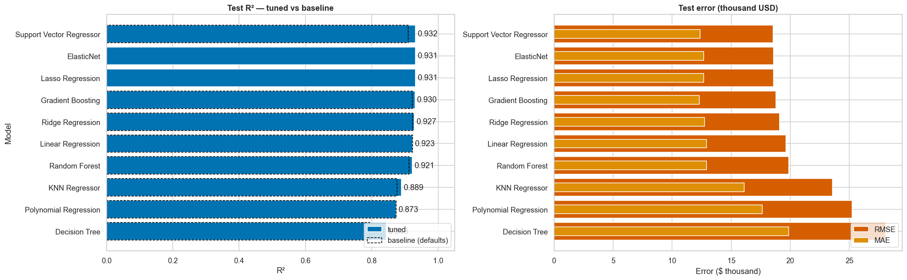
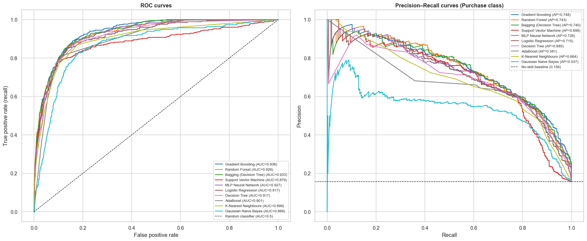
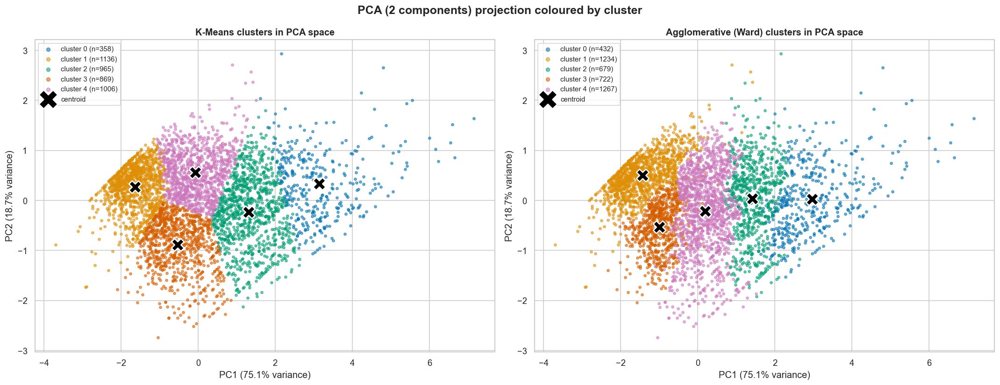

# 23CSE301 Machine Learning — Capstone Project

**End-to-end machine-learning pipelines for regression, classification and clustering**
**Team Zenith** · B.Tech Computer Science & Engineering · III Year · Academic Year 2026–27

**🚀 Live dashboard: [gauresh1036.streamlit.app](https://gauresh1036.streamlit.app)**

[](https://gauresh1036.streamlit.app)    

| | Regression | Classification | Clustering |
|---|---|---|---|
| **Dataset** | Ames Housing | Online Shoppers Purchasing Intention | Online Retail (UCI) |
| **Question** | What will this house sell for? | Will this browsing session end in a purchase? | Which groups of customers behave alike? |
| **Algorithms** | 10 | 10 (Part A + Part B) | 2 (K-Means, Agglomerative) |
| **Final model** | ElasticNet (log target) | Gradient Boosting | K-Means, k = 5 |
| **Headline result** | R² **0.931**, RMSE **$18,568** | weighted F1 **0.900**, ROC-AUC **0.936** | silhouette **0.318**, 5 actionable segments |
| **Notebook** | [`notebooks/regression.ipynb`](notebooks/regression.ipynb) | [`notebooks/classification.ipynb`](notebooks/classification.ipynb) | [`notebooks/clustering.ipynb`](notebooks/clustering.ipynb) |

---

## 1. Problem statements

1. **Regression — house-price valuation.** Predict the sale price (USD) of a residential property in Ames, Iowa from
   its size, quality, age, location and amenities, so buyers, sellers and lenders get an objective valuation.
2. **Classification — purchase intent.** From the behaviour recorded during an e-commerce session (pages, time spent,
   bounce/exit rates, page value, month, visitor type …), predict whether the session ends in a purchase
   (`Revenue`), so the shop can target high-intent visitors in real time. The classes are imbalanced (15.5 % buy).
3. **Clustering — customer segmentation.** Group the customers of a UK online gift retailer by purchasing behaviour
   (Recency, Frequency, Monetary value) **without any labels**, and turn the groups into marketing actions.

## 2. Datasets

| File (in [`data/`](data/)) | Rows × cols | Target | Source |
|------|------------|--------|--------|
| `housing.csv` | 2,930 × 82 | `SalePrice` (continuous) | De Cock (2011), *Journal of Statistics Education* |
| `online_shoppers_intention.csv` | 12,330 × 18 | `Revenue` (binary, 84.5 / 15.5 %) | UCI ML Repository #468, Sakar *et al.* (2019) |
| `Online Retail.xlsx` | 541,909 × 8 | — (unlabelled) | UCI ML Repository #352, Chen *et al.* (2012) |

Column descriptions, missing-value notes and citations are in [`data/README.md`](data/README.md).

## 3. Repository structure

```
ML_Capstone/
├── README.md                    ← this file (problem, data, results, setup, how to run)
├── requirements.txt             ← pinned dependencies (Python 3.13)
├── data/                        ← the three raw datasets + data/README.md
├── notebooks/
│   ├── regression.ipynb         ← Ames Housing: EDA → preprocessing → 10 regressors → tuning → CV → diagnostics
│   ├── classification.ipynb     ← Online Shoppers: Part A + Part B (10 classifiers) → consolidated table → final model
│   └── clustering.ipynb         ← Online Retail: cleaning → RFM → K-Means + Agglomerative → metrics → PCA/t-SNE → segments
├── models/                      ← final fitted pipelines (.pkl, joblib) + models/README.md
├── reports/
│   ├── *_results.json           ← every reported metric, written by the notebooks (read by the GUI and this README)
│   ├── *_comparison.csv         ← comparison tables
│   └── figures/                 ← every notebook figure as PNG
├── app/                         ← Streamlit GUI (bonus): app.py + views/ (home, 3 tracks, methodology), data.py, theme.py, features.py
├── tests/test_models.py         ← checks that the saved models and the GUI reproduce the notebook results
├── .streamlit/config.toml       ← GUI theme
└── 23CSE301_ML_26_27_Capstone_Guidelines.pdf
```

## 4. Methodology (common to all tracks)

```
load & audit → EDA (+ written observations) → cleaning → feature engineering → split (80:20, stratified for classification)
   → ColumnTransformer fitted on TRAIN only → baseline model → GridSearchCV (5-fold CV on train) → test-set evaluation
   → consolidated comparison table → 5-fold CV of the top-2 → diagnostics → save pipeline + metrics (JSON)
```

* **No data leakage:** imputers, encoders and scalers live inside a scikit-learn `ColumnTransformer` that is fitted
  on the training split only. Cross-validation re-fits the whole pipeline inside every fold.
* **Fair comparison:** within a track every algorithm sees exactly the same preprocessed data and the same test split.
* **Honest tuning:** every hyper-parameter is chosen by 5-fold CV on the training data, never on the test set. Each
  table reports the *baseline* (library defaults) next to the *tuned* score.
* **Reproducibility:** `random_state = 42` everywhere. All notebooks run top-to-bottom without errors.
* **Visual standards:** every plot has a title, axis labels and a legend, uses the colour-blind-safe `colorblind`
  palette and `tight_layout` / `bbox_inches='tight'`, and is followed by a written observation.

## 5. Results

### 5.1 Regression — Ames Housing (test split: 581 houses)

| Rank | Model | R² | RMSE ($) | MAE ($) | R² before tuning | Best hyper-parameters |
|-----:|-------|---:|---------:|--------:|-----------------:|-----------------------|
| 1 | Support Vector Regressor | 0.9315 | 18,533 | 12,368 | 0.9097 | `{'C': 0.01, 'epsilon': 0.05, 'kernel': 'linear'}` |
| 2 | **ElasticNet** | 0.9313 | 18,568 | 12,660 | -0.0415 | `{'alpha': 0.001, 'l1_ratio': 0.3}` |
| 3 | Lasso Regression | 0.9313 | 18,572 | 12,668 | -0.0415 | `{'alpha': 0.0003162}` |
| 4 | Gradient Boosting | 0.9298 | 18,769 | 12,290 | 0.9221 | `{'learning_rate': 0.1, 'max_depth': 2, 'n_estimators': 600, 'subsample': 0.8}` |
| 5 | Ridge Regression | 0.9275 | 19,075 | 12,730 | 0.9228 | `{'alpha': 31.62}` |
| 6 | Linear Regression | 0.9234 | 19,610 | 12,909 | 0.9234 | `— (no hyper-parameters)` |
| 7 | Random Forest | 0.9215 | 19,849 | 12,916 | 0.9120 | `{'max_depth': 20, 'max_features': 0.33, 'n_estimators': 400}` |
| 8 | KNN Regressor | 0.8893 | 23,568 | 16,095 | 0.8760 | `{'n_neighbors': 5, 'p': 1, 'weights': 'distance'}` |
| 9 | Polynomial Regression | 0.8732 | 25,227 | 17,634 | 0.8732 | `{'degree': 1}` |
| 10 | Decision Tree | 0.8430 | 28,067 | 19,856 | 0.7931 | `{'max_depth': 10, 'min_samples_leaf': 10}` |

* **Best model: ElasticNet.** 5-fold CV R² **0.9311 ± 0.0104**,
  test MAE $12,660; the median prediction is within about 6 % of the true price.
* Modelling `log(SalePrice)` turned SVR from R² −0.04 (Review 1) into a top model, and lifted the best test R² from
  0.924 (Review 1) to 0.931.
* Engineered `TotalSF` is the most correlated feature (r = 0.82) and the top Gradient-Boosting importance.



### 5.2 Classification — Online Shoppers (test split: 2,441 sessions, stratified)

Consolidated table of **all ten algorithms** (tuned), ranked by weighted F1:

| Rank | Model | Part | Accuracy | Precision (w) | Recall (w) | F1 (w) | ROC-AUC | F1 before tuning |
|-----:|-------|:----:|---------:|--------------:|-----------:|-------:|--------:|-----------------:|
| 1 | **Gradient Boosting** | B | 0.9029 | 0.8982 | 0.9029 | 0.8998 | 0.9358 | 0.8977 |
| 2 | Random Forest | B | 0.9029 | 0.8979 | 0.9029 | 0.8995 | 0.9285 | 0.8963 |
| 3 | Bagging (Decision Tree) | B | 0.9017 | 0.8972 | 0.9017 | 0.8988 | 0.9326 | 0.8861 |
| 4 | Support Vector Machine | A | 0.9021 | 0.8960 | 0.9021 | 0.8975 | 0.8785 | 0.8975 |
| 5 | MLP Neural Network | B | 0.8996 | 0.8958 | 0.8996 | 0.8973 | 0.9271 | 0.8736 |
| 6 | Logistic Regression | A | 0.8955 | 0.8914 | 0.8955 | 0.8931 | 0.9174 | 0.8931 |
| 7 | Decision Tree | A | 0.8959 | 0.8905 | 0.8959 | 0.8924 | 0.9174 | 0.8601 |
| 8 | AdaBoost | B | 0.8873 | 0.8865 | 0.8873 | 0.8869 | 0.9015 | 0.8905 |
| 9 | K-Nearest Neighbours | A | 0.8890 | 0.8806 | 0.8890 | 0.8827 | 0.8986 | 0.8870 |
| 10 | Gaussian Naive Bayes | A | 0.8251 | 0.8823 | 0.8251 | 0.8423 | 0.8691 | 0.7641 |

* **Best model: Gradient Boosting** (`learning_rate=0.03, max_depth=4, n_estimators=200, subsample=1.0`):
  best on test F1 and ROC-AUC **and** on 5-fold CV (F1 **0.8989 ± 0.0051**,
  ROC-AUC 0.9302).
* A business-tuned decision threshold of **0.31** (chosen on out-of-fold training
  predictions) raises purchase-class recall from 0.62 to 0.74.
* The engineered `HasPageValue` flag separates 56 % vs 4 % conversion. `PageValues` is by far the most important feature.



### 5.3 Clustering — Online Retail (4,334 customers, RFM, k = 5)

| Algorithm | Silhouette ↑ | Davies–Bouldin ↓ | Calinski–Harabasz ↑ |
|-----------|-------------:|-----------------:|--------------------:|
| **K-Means (k=5, k-means++)** | 0.3182 | 0.9829 | 3,231.0 |
| Agglomerative (k=5, Ward) | 0.2226 | 1.3071 | 2,505.4 |

Agreement between the two algorithms: ARI = 0.422. PCA with two components keeps
93.9 % of the variance.

| Segment | Customers | Median recency (days) | Median orders | Median spend (£) | Share of revenue |
|---------|----------:|----------------------:|--------------:|-----------------:|-----------------:|
| Champions | 358 (8.3 %) | 8 | 15 | 5,795 | 53.8 % |
| Loyal Customers | 965 (22.3 %) | 17 | 5 | 1,717 | 22.7 % |
| At-Risk | 1,006 (23.2 %) | 83 | 3 | 981 | 16.3 % |
| New / Promising | 869 (20.1 %) | 26 | 1 | 336 | 3.7 % |
| Lost / Hibernating | 1,136 (26.2 %) | 219 | 1 | 239 | 3.5 % |

* **k = 5** sits at the elbow of the inertia curve and at a Davies–Bouldin minimum. It is also the first k that
  isolates the **Champions**: 8.3 % of customers who generate 53.8 % of revenue.
* The segments are perfectly ordered by an independent quintile RFM score, which was **not** used for fitting.



## 6. Environment setup

Requirements: **Python 3.13** (3.11+ works) and about 1 GB of disk space.

```bash
git clone https://github.com/gauresh1036/ML_Capstone.git
cd ML_Capstone
python -m venv .venv
.venv\Scripts\activate            # Windows   (macOS/Linux: source .venv/bin/activate)
pip install -r requirements.txt
```

## 7. How to run

**Notebooks (interactive):**

```bash
jupyter notebook notebooks/
```

Open a notebook and choose *Kernel → Restart & Run All*. Run order does not matter; each notebook is self-contained.
Approximate run times on a 16-core laptop: clustering ≈ 4 min, classification ≈ 8 min, regression ≈ 6 min (grid searches).

**Notebooks (headless, regenerates every model, metric and figure):**

```bash
python -m nbconvert --to notebook --execute --inplace notebooks/regression.ipynb
python -m nbconvert --to notebook --execute --inplace notebooks/classification.ipynb
python -m nbconvert --to notebook --execute --inplace notebooks/clustering.ipynb
```

**GUI (bonus):** deployed publicly at **https://gauresh1036.streamlit.app** (Streamlit Community Cloud). To run it locally:

```bash
streamlit run app/app.py
```

The app is a full project showcase. Each track page has **Overview · Explore the data (interactive EDA) · All 10 models
(comparison, tuning gains, CV) · Model lab (test any of the 10 models on your own input and compare all of them) ·
Evaluate a model (live confusion matrix / ROC / threshold slider or predicted-vs-actual on the test split) · Notebook
figures**. The clustering page adds switchable PCA / t-SNE / 3-D views of both algorithms, segment profiles and a
segment finder. The app loads only the saved models and JSON metrics, so it always matches the notebooks. See
[`app/README.md`](app/README.md) for free public deployment on Streamlit Community Cloud.

**Consistency tests:**

```bash
python -m pytest tests -q
```

## 8. Rubric coverage (Review 2)

| Criterion | Where |
|-----------|-------|
| A1 — 5 Part-B classifiers on the same data as Part A | `classification.ipynb` §6.1–6.5 |
| A2 — single table, all 10 classifiers × Accuracy / Precision / Recall / F1 / ROC-AUC | `classification.ipynb` §7 |
| A3 — final model, justification, tuning, documented improvement | `classification.ipynb` §7.1, §8 |
| B1 — K-Means and Agglomerative fitted, labels obtained | `clustering.ipynb` §4.2, §5.3 |
| B2 — Silhouette, Davies–Bouldin, Calinski–Harabasz; Elbow curve; Dendrogram | `clustering.ipynb` §4.1, §5.1–5.2, §6 |
| B3 — PCA 2-D scatter for every algorithm; t-SNE | `clustering.ipynb` §7.1, §7.2 |
| C1 — clean top-to-bottom notebooks, modular helper functions, comments | all notebooks (§0 helpers) |
| C2 — README: dataset, problem, results table, setup, how to run | this file |
| C3 — meaningful commit history; `requirements.txt` | git log; `requirements.txt` |
| Bonus — GUI + public deployment | `app/` · live at https://gauresh1036.streamlit.app |

## 9. Academic integrity & AI assistance

* All datasets are public and cited above. Library usage follows the official scikit-learn, pandas, SciPy and Streamlit
  documentation; the knee-detection helper in `clustering.ipynb` follows the idea of Satopää *et al.* (2011),
  *Finding a "Kneedle" in a Haystack*.
* **AI disclosure (guideline 7.5):** generative-AI assistants (Google Antigravity during Review 1; Anthropic Claude
  during Review 2) were used for code scaffolding, refactoring, plotting boilerplate and documentation formatting.
  The team reviewed, executed and verified all code and outputs, and is responsible for the analysis,
  interpretations and design decisions presented here.

## 10. References

1. De Cock, D. (2011). Ames, Iowa: Alternative to the Boston Housing Data as an End of Semester Regression Project. *Journal of Statistics Education*, 19(3).
2. Sakar, C.O., Polat, S.O., Katircioglu, M. & Kastro, Y. (2019). Real-time prediction of online shoppers' purchasing intention using multilayer perceptron and LSTM recurrent neural networks. *Neural Computing and Applications*, 31, 6893–6908.
3. Chen, D., Sain, S.L. & Guo, K. (2012). Data mining for the online retail industry: A case study of RFM model-based customer segmentation using data mining. *Journal of Database Marketing & Customer Strategy Management*, 19, 197–208.
4. Pedregosa, F. *et al.* (2011). Scikit-learn: Machine Learning in Python. *JMLR*, 12, 2825–2830.
